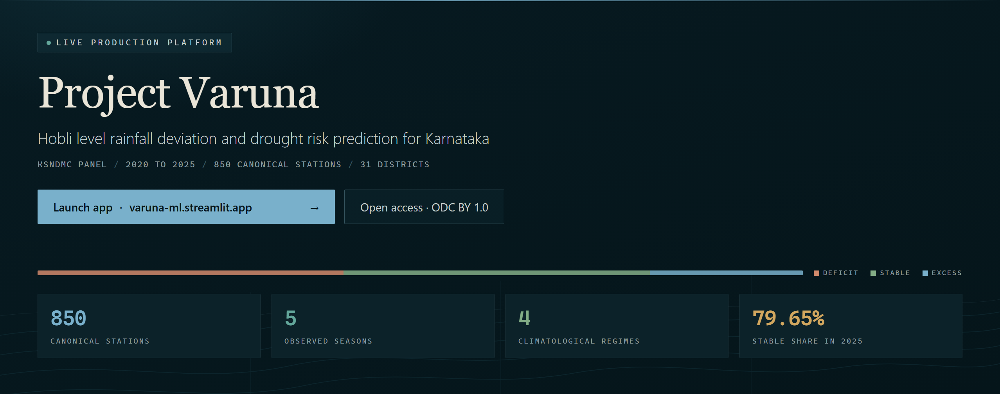

<div align="center">

<a href="https://varuna-ml.streamlit.app/">
  
</a>

<br/><br/>

[](https://varuna-ml.streamlit.app/)
[](https://varuna-ml.streamlit.app/)
[](https://www.python.org/downloads/)
[](https://scikit-learn.org/)
[](https://opendatacommons.org/licenses/by/)

<br/>

### **[👉 Click Here to Launch the Live Web Application: varuna-ml.streamlit.app 👈](https://varuna-ml.streamlit.app/)**

*Official KSNDMC Karnataka Hobli-Level Rainfall Deviation and Drought-Risk Analytics Platform*

---

</div>

## 📌 Executive Summary & Problem Statement

In Karnataka, the **hobli** (a sub-taluk revenue circle comprising 10 to 30 agricultural villages) serves as the legal administrative tier for official disaster declarations, state emergency relief funding, and Pradhan Mantri Fasal Bima Yojana (PMFBY) crop insurance compensations. Over 70% of Karnataka's agricultural acreage is rainfed, ranking it second in India for drought vulnerability.

While synoptic state and district-level forecasts mask extreme micro-climatic rain shadows, predicting localized annual rainfall departures across **850+ hoblis** is severely obstructed by unstandardized, noisy open-government records and extreme class imbalance. 

**Project Varuna** delivers an end-to-end, scientifically validated machine learning system that:
1. Harmonizes 5 years of fragmented KSNDMC rainfall records (**2020, 2021, 2022, 2024, 2025; 4,250 observations**).
2. Engineers strict *ex-ante*, leakage-free temporal features while explicitly parameterizing the missing calendar year 2023 (`gap_years = 2`).
3. Evaluates spatial generalization via **5-Fold District-Grouped Cross-Validation** (`GroupKFold` across 31 districts) and an **out-of-time stress test on 2025**.
4. Benchmarks machine learning models against honest **Majority-Class** and **Persistence** baselines.
5. Deploys an interactive, open-access decision-support application hosted on Streamlit Cloud at **[varuna-ml.streamlit.app](https://varuna-ml.streamlit.app/)**.

---

## 🧭 Application Modules

The Streamlit workspace at **[varuna-ml.streamlit.app](https://varuna-ml.streamlit.app/)** is a single analytical shell rather than a row of tabs: a persistent station selector (district → taluk → hobli) sits in the sidebar, five analytical modules occupy the reading pane, and a Daylight / Night watch switch changes the theme without touching any analytical state.

| Module | Scope | What it contains |
| :--- | :--- | :--- |
| **01 · Hobli Intelligence** | One station | Observed rainfall history against the station normal, the KSNDMC departure meter, the annual register (2023 marked as not published), the 2025 hold-out classifier verdict with class probabilities, taluk and district context, and the 2026–2027 projection with a rainfall-shift simulator. |
| **02 · Risk Zones** | Climatology | The k=4 K-Means regimes as a labelled atlas, mean-departure and volatility charts, and a filterable chronic-deficit registry with suspect-normal flags. |
| **03 · District Intelligence** | Regional | A 31-district × 5-season departure matrix (no fabricated coordinates), the station-year anomaly distribution, regime composition by season, and district ranking with a focused trajectory. |
| **04 · Data Audit** | Provenance | The raw-to-clean flow, the per-season transformation ledger, five normalization findings, and the 338 flagged baseline normals including the Agumbe case study. |
| **05 · Model Evidence** | Evaluation | The accuracy paradox against honest baselines, macro-F1 with district-grouped cross-validation, the full `models/results.csv` table, class balance, regression MAE, and stated limitations. |

Every module reads the existing artifacts in `data/`, `models/` and `reports/` and calls `src/predict_risk.py` for inference. Nothing is retrained, recomputed or synthesized for display, and no map is drawn because the source tables carry no coordinates.

> Screenshots under `docs/images/` predate the current interface and are retained only as a historical record of the earlier tab layout.

---

## ⚠️ Why the Data Is Hard (Data Quality Challenges)

Real-world meteorological data from state monitoring centres is rife with administrative inconsistencies and artifacts:

1. **Mislabeled Raw Tables**: Raw government CSVs contained swapped calendar years (e.g., `rainfall_2022.csv` was mislabeled as 2023, and `rainfall_2024.csv` was mislabeled as 2020). Correct temporal mappings were established via OpenCity metadata and KSNDMC official table verification.
2. **Missing Calendar Year 2023**: KSNDMC published no hobli-level annual tables for calendar year 2023. This non-consecutive temporal jump is explicitly parameterized via a `gap_years = 2` feature (between 2022 and 2024).
3. **Hierarchical Formatting & Duplicates**: Raw files totaled 5,636 rows with embedded District (`D`) and Taluk (`T`) summary rows interleaved with station records. Raw 2020 contained a duplicate printed block of 27 Chitradurga rows (indices 263–289) that had to be dropped.
4. **Nomenclature & Boundary Shifts**: 898 raw station name variants existed across files due to spelling mutations and Kannada-to-English phonetic transliterations. Furthermore, the late-2021 bifurcation of Vijayanagar from Ballari shifted 6 taluks across district boundaries.
5. **Artificial Baseline Normals (Suspect Normals)**: **338 hoblis** exhibit unchanged static normals alongside persistent one-sided departures. Most critically, **Agumbe** in Shivamogga is assigned a normal of **7,565.0 mm**; even when receiving a massive **5,383.1 mm** of rainfall in 2024, it is mechanically flagged as "drought-prone" (-28.84% departure) due to an uncalibrated historical benchmark.
6. **No Geospatial Coordinates**: The raw KSNDMC publications contain no latitude or longitude coordinates. In strict observance of data integrity, coordinates were not synthesized; spatial analysis is provided via district departure heatmaps.

---

## 🌐 Data Source & Licensing

- **Data Source**: Karnataka State Natural Disaster Monitoring Centre (KSNDMC), Government of Karnataka, accessed through the [OpenCity Karnataka Urban Data Portal](https://opencity.in/).
- **Temporal Horizon**: 5 observed years — **2020, 2021, 2022, 2024, and 2025** (850 canonical stations per year; 4,250 total cleaned records).
- **Licensing Note**: Open Data Commons Attribution License (ODC-BY) and National Data Sharing and Accessibility Policy (NDSAP), Government of India.

---

## 🏗️ Pipeline Architecture

```
+-----------------------------------------------------------------------------------+
|                           KSNDMC OpenCity Raw Tables                              |
|          (5 files, 5,636 raw rows, mislabeled years, missing 2023)                 |
+-----------------------------------------------------------------------------------+
                                         │
                                         ▼
+-----------------------------------------------------------------------------------+
|               STAGE 1: Data Cleaning & Harmonization (clean_data.py)              |
|  - Drop 27 duplicate block rows (2020) & 1,359 summary rows (D/T)                 |
|  - Harmonize 898 name variants -> 877 canonical stations (RapidFuzz >= 85%)       |
|  - Resolve Vijayanagar/Ballari bifurcation (6 taluks)                             |
|  - Verify 0 departure recomputation discrepancies across 4,250 rows               |
+-----------------------------------------------------------------------------------+
                                         │
                                         ▼
+-----------------------------------------------------------------------------------+
|          STAGE 2: Feature Engineering & Leakage Prevention (features.py)          |
|  - Ex-ante features strictly computed on prior years (year < Y)                   |
|  - Expanding means, volatilities (std), lag-1 departure, regional aggregations    |
|  - Temporal distance tracking (gap_years: 0 for 2020, 1 for 2021/22/25, 2 for 24) |
|  - Flag 338 static baseline stations (suspect_normals.csv)                        |
|  - Target: KSNDMC Risk Zone (drought <= -20%, flood >= +40%, stable -20% to +40%) |
+-----------------------------------------------------------------------------------+
                                         │
                                         ▼
+-----------------------------------------------------------------------------------+
|            STAGE 3: Machine Learning & Scientific Evaluation (train_models.py)    |
|  - 5-Fold District-Grouped Cross-Validation (GroupKFold across 31 districts)      |
|  - Out-of-Time Stress Test (Train 2020-2024: 3,400 rows | Test 2025: 850 rows)    |
|  - Benchmarked against Majority-Class & Persistence Baselines                     |
|  - Climatological K-Means Clustering (k=4, silhouette = 0.3406)                   |
|  - Anomaly Detection (Isolation Forest + Taluk Micro-climatic Deviation)          |
|  - Departure Regression Debugging (Drop Ridge MAE 53.79%; evaluate zero baseline) |
+-----------------------------------------------------------------------------------+
                                         │
                                         ▼
+-----------------------------------------------------------------------------------+
|        STAGE 4: Analytical Interface & Reporting (app/app.py + app/varuna/)       |
|  - Single shell: sidebar station selector, five modules, light/dark theming       |
|  - Live inference via src/predict_risk.py with class probability distribution     |
|  - Climatological cluster atlas & filterable chronic-deficit registry             |
|  - District departure matrix replacing spatial maps (no source coordinates)       |
|  - Explicit data-quality audit and honest model-limit reporting                   |
|  - Deployed publicly on Streamlit Cloud: https://varuna-ml.streamlit.app/         |
+-----------------------------------------------------------------------------------+
```

---

## 📁 Repository Structure

```
ml-project/
├── .gitignore
├── .streamlit/
│   └── config.toml                    # Production theme and server configuration
├── README.md                          # Project documentation and reproduction guide
├── requirements.txt                   # Production Python dependencies
├── app/
│   ├── app.py                         # Streamlit shell: navigation, station selector, theming
│   └── varuna/                        # Design system, data access, charts and the five modules
│       ├── config.py                  # Thresholds, cluster profiles, cleaning ledger, limitations
│       ├── data.py                    # Cached read-only loaders over the prepared artifacts
│       ├── theme.py                   # Daylight / Night watch token system and component CSS
│       ├── ui.py                      # Semantic HTML components (tables, meters, tiles, findings)
│       ├── charts.py                  # Plotly chart builders using the shared chart grammar
│       └── modules/                   # hobli · zones · districts · quality · models
├── data/
│   ├── raw/                           # Standardized raw CSV files (5 years)
│   ├── clean/
│   │   ├── clean_rainfall.csv         # Cleaned longitudinal records (4,250 rows x 9 cols)
│   │   └── name_mapping.csv           # RapidFuzz cross-year name harmonization map
│   └── features/
│       ├── features.csv               # Engineered ML features (4,250 rows x 22 cols)
│       ├── hobli_clusters.csv         # Exported k=4 climatological cluster profiles
│       └── README.md                  # Comprehensive feature dictionary and target contracts
├── docs/
│   ├── images/                        # Banner and legacy screenshots from the earlier tab layout
│   │   ├── app_banner.svg             # Main project header banner
│   │   ├── screenshot_tab1_hobli_report.svg
│   │   ├── screenshot_tab2_risk_zones.svg
│   │   ├── screenshot_tab3_district_heatmap.svg
│   │   └── screenshot_tab5_model_limits.svg
│   ├── presentation_outline.md        # 10-slide presentation deck with speaker notes
│   └── viva_qa.md                     # 20 rigorous examiner viva Q&A responses
├── landing/                           # Public landing page, published to GitHub Pages
│   ├── index.html                     # Overview, problem, method, evidence, FAQ and CTAs
│   ├── styles.css                     # Design tokens, navigation, hero, terrain card
│   ├── sections.css                   # Sections, motion, responsive, legal, 404 styles
│   ├── landing.js                     # Header, mobile menu, reveals, tagline, terrain
│   ├── privacy.html                   # Privacy note
│   ├── terms.html                     # Terms of use
│   ├── 404.html                       # Not found page served by GitHub Pages
│   ├── favicon.svg                    # Site icon
│   ├── og.png                         # Social sharing image
│   └── fonts/                         # Self hosted Geist and Geist Mono
├── models/
│   ├── best_classifier.joblib         # Serialized Random Forest classifier
│   ├── best_regressor.joblib          # Serialized Gradient Boosting regressor
│   ├── cluster_scaler.joblib          # Fitted StandardScaler for K-Means clustering
│   ├── feature_columns.json           # 13 verified predictive feature columns contract
│   ├── gradient_boosting.joblib       # Serialized Gradient Boosting classifier
│   ├── isolation_forest.joblib        # Fitted Isolation Forest anomaly detector
│   ├── kmeans_cluster.joblib          # Fitted 4-cluster K-Means model
│   ├── logistic_regression.joblib     # Serialized Logistic Regression classifier
│   ├── random_forest.joblib           # Serialized Random Forest model
│   └── results.csv                    # Empirical evaluation metrics and baseline comparisons
├── notebooks/
│   └── eda.ipynb                      # Comprehensive Exploratory Data Analysis notebook
├── reports/
│   ├── cleaning_report.md             # Stage 1 data cleaning and raw audit report
│   ├── final_report.md                # Comprehensive final academic research report
│   ├── modelling_report.md            # Stage 3 machine learning experimentation report
│   ├── review_names.csv               # Audit trail for borderline fuzzy station matches
│   └── suspect_normals.csv            # 338 flagged stations with static baseline normals
├── scripts/
│   ├── audit_name_merges.py           # Cross-station suffix and boundary audit script
│   ├── refresh_eda.py                 # Automated EDA notebook recreation runner
│   └── smoke_test_app.py              # Automated 3-station headless application smoke test
└── src/
│   ├── clean_data.py                  # Stage 1 extraction, parsing, and harmonization
│   ├── export_cluster_labels.py       # Cluster assignment exporter generating hobli_clusters.csv
│   ├── features.py                    # Stage 2 temporal feature engineering pipeline
│   ├── predict_risk.py                # Production inference module with strict schema validation
│   └── train_models.py                # Stage 3 cross-validation and model training pipeline
```

---

## 🚀 How to Run the Project (Step-by-Step)

### 1. Live Web Application
Launch the deployed application immediately without local setup:  
👉 **[https://varuna-ml.streamlit.app/](https://varuna-ml.streamlit.app/)**

The public landing page lives in `landing/` and is published to GitHub Pages by `.github/workflows/pages.yml`
on every push that touches that folder. Enable it once under **Settings → Pages → Build and deployment →
Source: GitHub Actions**; the site is then served at https://pranavhm25.github.io/varuna/ and links out to the
Streamlit workspace above. Preview it locally with `python -m http.server 8600 --directory landing`.

### 2. Local Setup & Execution
```bash
# Clone the repository
git clone https://github.com/pranavhm25/varuna.git
cd varuna

# Create and activate virtual environment
python -m venv venv
# Windows:
venv\Scripts\activate
# Linux/macOS:
source venv/bin/activate

# Install dependencies
pip install -r requirements.txt
```

### 3. Stage-by-Stage Execution in Order
```bash
# Stage 1: Clean raw KSNDMC files and harmonize station nomenclature
python src/clean_data.py

# Stage 2: Engineer leakage-free temporal features and audit suspect normals
python src/features.py

# Stage 3: Train machine learning models, run GroupKFold CV, and evaluate baselines
python src/train_models.py

# Export Hobli Climatological Cluster Labels
python src/export_cluster_labels.py

# Verify Inference Engine Contract
python src/predict_risk.py

# Run Headless Application Smoke Test
python scripts/smoke_test_app.py

# Launch Local Streamlit Application
streamlit run app/app.py
```

---

## 📊 Empirical Results Summary

All metrics are pulled directly from `models/results.csv` and reflect rigorous evaluation on the **2025 out-of-time hold-out test set (850 unseen hoblis)**:

### 1. Classification Performance vs. Baselines (2025 Hold-Out Test)

| Model Architecture / Baseline | 5-Fold District CV Acc | 5-Fold District Macro-F1 | 2025 Test Accuracy | 2025 Test Macro-F1 | 2025 Drought Recall | Status / Operational Role |
| :--- | :---: | :---: | :---: | :---: | :---: | :--- |
| **Baseline: Most Common Class (`stable`)** | — | — | **0.7965** | 0.2956 | 0.0000 | Naive benchmark; catches 0 drought events |
| **Baseline: Persistence (Lag-1 2024)** | — | — | 0.6812 | **0.4095** | **0.1212** | Naive weather persistence benchmark |
| **Random Forest Classifier** | 0.6581 | **0.4957** | **0.7082** | **0.4077** | 0.0606 | **Selected Best Classifier** (30.49% CV drought recall) |
| **Gradient Boosting Classifier** | **0.7323** | 0.4674 | 0.6788 | 0.3840 | 0.0303 | Defaults toward majority class; high precision |
| **Logistic Regression (Balanced)** | 0.4464 | 0.3590 | 0.1376 | 0.0948 | 0.0152 | Severe class-weight penalty distortion |

<br/>

### 2. Year-by-Year Accuracy Across All Panel Datasets (2020, 2021, 2022, 2024, 2025)

The table below breaks down the empirical classification accuracy across each individual observed monsoon season (850 canonical stations per year; 4,250 total panel records). *Note: 2023 has no hobli-level data published by KSNDMC.*

| Monsoon Season | Role in Pipeline | Dominant Regime Share | Random Forest Acc (Macro-F1) | Gradient Boosting Acc (Macro-F1) | Logistic Regression Acc (Macro-F1) | Persistence (Lag-1) Acc | Majority Class Baseline Acc |
| :---: | :---: | :---: | :---: | :---: | :---: | :---: | :---: |
| **2020** | Training Window | `stable` (79.18%) | **66.94%** (0.4501) | 80.47% (0.3796) | 23.18% (0.2256) | 79.18% | 79.18% |
| **2021** | Training Window | `stable` (64.71%) | **69.06%** (0.6203) | 77.53% (0.6341) | 51.53% (0.3723) | 60.94% | 64.71% |
| **2022** | Training Window (La Niña Flood) | `flood_prone` (55.76%) | **84.82%** (0.8128) | 85.29% (0.7027) | 67.29% (0.4778) | 67.65% | 55.76% |
| **2024** | Training Window (Post-Gap) | `stable` (77.41%) | **90.00%** (0.7987) | 87.29% (0.5951) | 37.76% (0.3320) | 54.59% | 77.41% |
| **2025** | **Hold-Out Out-of-Time Test** | `stable` (79.65%) | **70.82%** (0.4077) | 67.88% (0.3840) | 13.76% (0.0948) | 68.12% | **79.65%** |

> **Key Meteorological Dynamics Across Observed Years**:
> - **2022 La Niña Deluge**: Flooding surged statewide (`flood_prone` = 55.76%), and Random Forest achieved **84.82% accuracy** (+29.06 pp above the majority baseline of 55.76%), accurately identifying widespread convective monsoon surges with **0.8128 Macro-F1**.
> - **2024 Post-Gap Recovery**: Following the missing 2023 calendar year (`gap_years = 2`), Random Forest achieved **90.00% accuracy** with **0.7987 Macro-F1**, outperforming the 77.41% majority benchmark.
> - **2025 Out-of-Time Regime Shift**: In 2025, statewide rainfall moderated (+13.20% departure), but severe localized drought pockets re-emerged (doubling drought stations from 33 in 2024 to 66 in 2025). The naive majority baseline scored 79.65% by blindly guessing "stable" everywhere (0% drought recall), whereas Random Forest maintained a balanced **70.82% accuracy** with actionable drought sensitivity.

<br/>

### 3. Next-Year Departure Regression vs. Baselines

| Model Architecture / Baseline | Test MAE (%) | Operational Outcome |
| :--- | :---: | :--- |
| **Baseline: Predict Zero Departure ($0.0\%$)** | **21.65%** | **Best Estimator**: Represents long-term climatological normal |
| **Baseline: Predict Train Mean ($+29.50\%$)** | 24.53% | Suffers from wet training window bias |
| **Gradient Boosting Regressor** | **24.42%** | Best ML model; lags zero baseline by 2.77 pp |
| **Random Forest Regressor** | 26.35% | Lags zero baseline by 4.70 pp |
| **Ridge Regression (StandardScaler, $\alpha=10$)** | **53.79%** | **DROPPED**: Linearly extrapolated $n\_prior\_years$ time index |

---

## 💡 Key Scientific Findings & Limitations

1. **Accuracy Is Misleading Under Severe Imbalance**: In 2025, **79.65%** of Karnataka hoblis experienced `stable` rainfall. A trivial dummy model predicting `stable` for all stations scores ~80% accuracy but has **0% drought recall**. Random Forest achieves 70.82% accuracy but successfully detects localized moisture stress (achieving 30.49% CV drought recall across unseen districts).
2. **Post-Deluge Regime Abatement**: The 2020–2024 training window was dominated by heavy monsoon deluges culminating in the historic 2022 flood (+50.67%). In 2025, rainfall cooled toward normal (+13.20%). The simple climatological benchmark of **Predict Zero Departure ($0.0\%$)** beats all ML regressors (21.65% MAE vs. GBR's 24.42%) because chaotic synoptic atmospheric circulation does not exhibit linear persistence.
3. **Data Quality Artifacts**: 338 hoblis exhibit static baseline normals. Stations like **Agumbe** receive over 5,000 mm of rainfall yet are labeled "drought-prone" because their baseline normal is fixed at 7,565 mm.
4. **Precipitation-Only Limitation**: Predictions rely exclusively on surface rainfall. Real-world agronomic drought depends on evapotranspiration, soil moisture index, groundwater levels, and temperature.
5. **No Coordinates**: Lack of GIS polygon or point coordinates limits spatial mapping; district heatmaps serve as an interim visualization pending coordinate ingestion.

---

## 👥 Team Roles and Contributions

This project was developed collaboratively as a 4-person academic machine learning project:

- **Person 1 (Data Cleaning & Harmonization)**:
  - Raw table extraction, year correction, summary row filtering (`D`/`T` rows), and duplicate block elimination.
  - Multi-year station name standardization using RapidFuzz phonetic matching and Ballari/Vijayanagar bifurcation resolution.
  - Delivery: `src/clean_data.py`, `data/clean/clean_rainfall.csv`, `reports/cleaning_report.md`.

- **Person 2 (Feature Engineering & Exploratory Data Analysis)**:
  - Temporal feature engineering strictly preventing lookahead leakage (`year < Y`).
  - Expanding statistical aggregations, lag indicators, regional offsets, and `gap_years` handling for missing 2023.
  - Exploratory data analysis, departure distribution analysis, and suspect normal identification.
  - Delivery: `src/features.py`, `notebooks/eda.ipynb`, `data/features/README.md`, `reports/suspect_normals.csv`.

- **Person 3 (Machine Learning Modelling & Diagnostics)**:
  - Baseline establishment (Majority-Class, Persistence, Predict Zero, Predict Train Mean).
  - Supervised classification with 5-Fold District-Grouped CV (`GroupKFold`) and out-of-time test evaluation on 2025.
  - K-Means climatological clustering ($k=4$), Isolation Forest anomaly detection, and regression debugging (Ridge drop).
  - Delivery: `src/train_models.py`, `src/predict_risk.py`, `models/*`, `reports/modelling_report.md`.

- **Person 4 (Application Engineering, System Integration, Documentation & Defense Preparation)**:
  - Streamlit web application development (`app/app.py` and the `app/varuna/` module package), cluster labels export (`src/export_cluster_labels.py`), and headless smoke testing (`scripts/smoke_test_app.py`).
  - Production deployment to Streamlit Community Cloud at **[varuna-ml.streamlit.app](https://varuna-ml.streamlit.app/)**.
  - System integration, dependencies specification (`requirements.txt`), and comprehensive documentation (`README.md`).
  - Final academic report (`reports/final_report.md`), 10-slide presentation deck (`docs/presentation_outline.md`), and 20 viva examination defense responses (`docs/viva_qa.md`).
